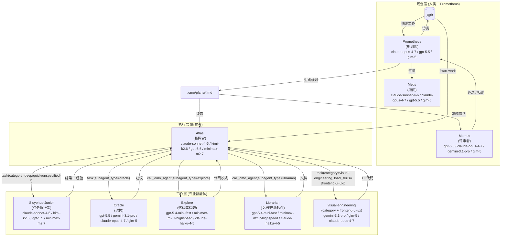
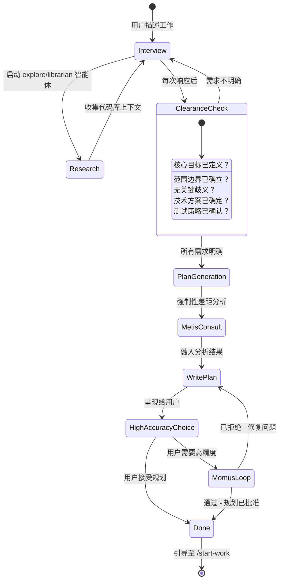
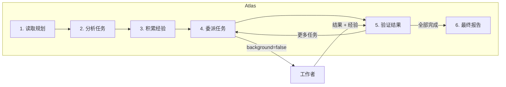

# 编排系统指南

Oh My OpenAgent 的编排系统通过**规划与执行的分离**，将一个简单的 AI 智能体转化为一个协同工作的开发团队。

---

## TL;DR: 选用指南

| 复杂度 | 方法 | 适用场景 |
| --------------------- | ------------------------- | ---------------------------------------------------------------------------------------- |
| **简单** | 直接提示 | 简单任务、快速修复、单文件修改 |
| **复杂 + 懒人模式** | 输入 `ulw` 或 `ultrawork` | 解释上下文很繁琐的复杂任务。智能体会自行解决。 |
| **复杂 + 精准模式** | `@plan` → `/start-work` | 需要真正编排的精准、多步骤工作。Prometheus 负责规划，Atlas 负责执行。 |

**决策流程：**

```
是否为快速修复或简单任务？
  └─ 是 → 正常进行提示即可
  └─ 否 → 解释完整上下文是否很繁琐？
              └─ 是 → 输入 "ulw"，让智能体自行解决
              └─ 否 → 是否需要精准、可验证的执行？
                         └─ 是 → 使用 @plan 让 Prometheus 进行规划，然后运行 /start-work
                         └─ 否 → 直接使用 "ulw"
```

---

## 系统架构

编排系统采用三层架构，通过专业分工与任务委派，解决上下文过载、认知漂移以及验证缺失的问题。



上图中的模型标签显示的是来自 `src/shared/model-requirements.ts` 的当前备用模型栈，而非市场宣传名称。

### 智能体清单与模式（当前）

系统拥有 **11 个内置智能体**：

- 主智能体 (Primary)：`sisyphus`、`hephaestus`、`prometheus`、`atlas`
- 子智能体 (Subagent)：`oracle`、`librarian`、`explore`、`multimodal-looker`、`metis`、`momus`、`sisyphus-junior`

主智能体的规范装配顺序为：

`Sisyphus → Hephaestus → Prometheus → Atlas`

模式区别：

- `mode: "primary"`：在 UI/CLI 中直接选择的顶级会话智能体
- `mode: "subagent"`：通过 `task(..., subagent_type="...")` 或 `call_omo_agent(...)` 调用的工作/顾问智能体

### 委派语义（重要）

- `task(category="...")` 会路由至 **Sisyphus-Junior**，并采用针对该类别优化的模型路由
- `task(subagent_type="...")` 会直接调用特定的智能体（例如 `oracle`、`explore`、`librarian`）
- 在单次调用中，类别 (Category) 与 `subagent_type` 是互斥的输入参数

---

## 规划：Prometheus + Metis + Momus

### Prometheus：您的战略顾问

Prometheus 不仅仅是一个规划者，它还是一个智能访谈者，能够帮助您理清实际需求。它是**只读的**，只能在 `.omo/` 目录下创建或修改 Markdown 文件。



**针对特定意图的策略：**

Prometheus 会根据您正在进行的工作调整其访谈风格：

| 意图 | Prometheus 关注点 | 示例问题 |
| ---------------------- | ------------------------------ | ---------------------------------------------------------- |
| **重构** | 安全性，行为保持 | “有哪些测试可以验证当前行为？”“回滚策略是什么？” |
| **从零构建** | 探索，模式优先 | “在代码库中发现了模式 X。是遵循它还是另辟蹊径？” |
| **中等规模任务** | 护栏，明确边界 | “有哪些内容是绝对不能包含的？硬性约束是什么？” |
| **架构** | 战略性，长期影响 | “预期的生命周期是多久？规模要求是什么？” |

### Metis：差距分析器

在 Prometheus 编写规划之前，Metis 会捕捉 Prometheus 遗漏的内容：

- 用户请求中隐藏的意图
- 可能导致实现偏离轨道的歧义
- AI 废话/冗余模式（过度设计、范围蔓延）
- 缺失的验收标准
- 未处理的边缘情况

**为什么存在 Metis：**

规划制定者 (Prometheus) 拥有“多动症般的工作记忆”，它会建立一些永远不会呈现在页面上的关联。Metis 强制将这些隐性知识显性化。

### Momus：无情的评审者

在最高精度模式下，Momus 会根据四个核心标准对规划进行验证：

1. **清晰度**：每个任务是否明确指出了在**哪里**可以找到实现细节？
2. **可验证性**：验收标准是否具体且可衡量？
3. **上下文**：是否有足够的上下文，使得在执行时无需超过 10% 的猜测？
4. **全局观**：目的、背景和工作流程是否清晰？

**Momus 循环：**

Momus 仅在满足以下条件时才会给出“通过 (OKAY)”：

- 100% 的文件引用已通过验证
- ≥80% 的任务具有明确的参考来源
- ≥90% 的任务具有具体的验收标准
- 零任务需要对业务逻辑进行主观假设
- 零关键红线问题

如果被“拒绝 (REJECTED)”，Prometheus 将修复问题并重新提交。没有最大重试次数限制。

---

## 执行：Atlas

### 指挥官思维

Atlas 就像一位管弦乐团的指挥：它不亲自演奏乐器，但它能确保完美的和谐。



**Atlas 可以做的事情：**

- 读取文件以理解上下文
- 运行命令以验证结果
- 使用 `lsp_diagnostics` 检查错误
- 使用 grep/glob/ast-grep 搜索模式

**Atlas 必须委派的事情：**

- 编写或编辑代码文件
- 修复 Bug
- 创建测试
- Git 提交

### 经验积累

编排的强大之处在于累积学习。在每个任务完成后：

1. 从子智能体的响应中提取经验教训
2. 将其分类为：规范 (Conventions)、成功经验 (Successes)、失败教训 (Failures)、注意事项 (Gotchas)、命令 (Commands)
3. 将这些经验传递给所有后续的子智能体

这可以防止重复犯错，并确保模式的一致性。

**记事本系统：**

```
.omo/notepads/{plan-name}/
├── learnings.md      # 模式、规范、成功的方法
├── decisions.md      # 架构选择与依据
├── issues.md         # 遇到的问题、阻碍、注意事项
├── verification.md   # 测试结果、验证产出
└── problems.md       # 未解决的问题、技术债
```

---

## 工作者：Sisyphus-Junior 与专业智能体

### Sisyphus-Junior：任务执行者

Junior 是实际编写代码的苦力。其关键特征包括：

- **专注**：无法进行委派（被禁止使用 task 工具）
- **纪律严明**：强迫症般的待办事项 (Todo) 跟踪
- **经过验证**：在完成前必须通过 `lsp_diagnostics` 验证
- **受约束**：无法修改规划文件（只读）

**为什么备用链已经足够：**

Junior 不需要是最聪明的，它只需要足够可靠。凭借：

1. 来自 Atlas 的详细提示词（50 到 200 行）
2. 向前传递的累积经验
3. 明确的“必须做 (MUST DO)”与“不能做 (MUST NOT DO)”约束
4. 验证要求

当运行环境足够严格时，即使是中等水平的执行模型也能很好地工作。目前备用顺序为 `claude-sonnet-4-6` → `kimi-k2.5` → `gpt-5.5` → `minimax-m2.7` → `big-pickle`。智慧存在于**系统**之中，而非单个工作者模型。

### 系统提醒机制

钩子系统确保 Junior 绝不会半途而废：

```
[SYSTEM REMINDER - TODO CONTINUATION]

您还有未完成的待办事项！在响应前请完成所有事项：
- [ ] 实现用户服务 ← 进行中
- [ ] 添加验证
- [ ] 编写测试

在所有待办事项被标记为已完成之前，请勿做出响应。
```

这种“推石头”机制正是该系统以 Sisyphus（西西弗斯）命名的原因。

---

## 类别与技能系统

### 为什么类别是革命性的

**模型名称带来的问题：**

```typescript
// 旧方式：模型名称会产生分布偏差
task({ agent: "gpt-5.5", prompt: "..." }); // 模型知道自己的局限性
task({ agent: "claude-opus-4-7", prompt: "..." }); // 不同的自我认知
```

**解决方案：语义类别：**

```typescript
// 新方式：类别描述的是“意图”，而非实现方式
task({ category: "ultrabrain", prompt: "..." }); // “进行战略性思考”
task({ category: "visual-engineering", prompt: "..." }); // “进行精美的设计”
task({ category: "quick", prompt: "..." }); // “快速搞定即可”
```

### 委派任务类别

在面向用户的编排中，`task(category="...")` 支持以下类别名称：

`visual-engineering`、`artistry`、`ultrabrain`、`deep`、`quick`、`unspecified-low`、`unspecified-high`、`writing`、`quick-rust`、`quick-zig`、`git`

注意：

- 内置默认值定义在 `src/tools/delegate-task/*-categories.ts` 和 `src/shared/model-requirements.ts` 中
- 项目/用户可以通过配置扩展类别，会话提示词中可能会出现其他类别名称
- 无论类别名称为何，类别分发都会通过 Sisyphus-Junior 进行

### 技能：特定领域的指令

技能会在子智能体的提示词前添加专门的指令：

```typescript
// 类别 + 技能组合
task(
  (category = "visual-engineering"),
  (load_skills = ["frontend-ui-ux"]), // 添加 UI/UX 专业知识
  (prompt = "..."),
);

task(
  (category = "deep"),
  (load_skills = ["playwright"]), // 添加浏览器自动化专业知识
  (prompt = "..."),
);
```

其加载优先级为：

`project > opencode > user > builtin`

### 技能嵌入式 MCP（第 3 层）

技能嵌入式 MCP 服务在每个会话中是隔离的，使用复合键模式：

`${sessionID}:${skillName}:${serverName}`

这可以防止在并发使用相同的技能/MCP 时，会话之间发生状态泄露。

### 后台任务并发

在未配置覆盖项时，后台任务并发数默认为 **5**。

- 按模型/服务商路由键进行标识
- 可通过 `background_task.defaultConcurrency`、`background_task.providerConcurrency` 和 `background_task.modelConcurrency` 进行配置

### 团队模式

团队模式是并行的多智能体编排，**默认关闭**。

对于 `subagent_type` 团队成员，当前的准入资格为：

- 准入：`sisyphus`、`atlas`、`sisyphus-junior`
- 有条件准入：`hephaestus`（需要启用队友权限）
- 强制拒绝：`oracle`、`librarian`、`explore`、`multimodal-looker`、`metis`、`momus`、`prometheus`

为什么 `oracle`/`prometheus` 在团队成员中被拒绝：

- Oracle 是只读的（无法写入/编辑/修补/委派）
- Prometheus 受到 `prometheus-md-only` 钩子的约束，只能写入 `.omo/*.md` 文件

---

## 使用模式

### 如何调用 Prometheus

**方法 1：切换到 Prometheus 智能体（Tab → 选择 Prometheus）**

```
1. 在提示符处按 Tab 键
2. 从智能体列表中选择 "Prometheus"
3. 描述您的工作：“我想重构认证系统”
4. 回答访谈问题
5. Prometheus 会在 .omo/plans/{name}.md 中创建规划
```

**方法 2：使用 @plan 命令（在 Sisyphus 中）**

```
1. 保持在 Sisyphus（默认智能体）中
2. 输入：@plan "我想重构认证系统"
3. @plan 命令会自动切换到 Prometheus
4. 回答访谈问题
5. Prometheus 会在 .omo/plans/{name}.md 中创建规划
```

**您应该使用哪种方法？**

| 场景 | 推荐方法 | 原因 |
| --------------------------------- | -------------------------- | ---------------------------------------------------- |
| **新会话，全新开始** | 切换到 Prometheus 智能体 | 清晰的心智模型，您正在进入“规划模式” |
| **已在 Sisyphus 中，工作中途** | 使用 @plan | 方便，无需切换智能体 |
| **需要显式控制** | 切换到 Prometheus 智能体 | 规划与执行上下文的清晰分离 |
| **快速的规划中断** | 使用 @plan | 从当前上下文出发的最快路径 |

两种方法都会触发相同的 Prometheus 规划流程。@plan 命令仅仅是一个便利的快捷方式。

### /start-work 行为与会话连续性

**当您运行 /start-work 时会发生什么：**

```
用户: /start-work
    ↓
[start-work 钩子激活]
    ↓
检查: .omo/boulder.json 是否存在？
    ↓
    ├─ 是 (存在已有工作) → 恢复模式 (RESUME MODE)
    │   - 读取现有的 boulder 状态
    │   - 计算进度（已勾选与未勾选的框）
    │   - 注入包含剩余任务的后续提示词
    │   - Atlas 从您上次中断的地方继续
    │
    └─ 否 (全新开始) → 初始化模式 (INIT MODE)
        - 在 .omo/plans/ 中查找最新的规划
        - 创建跟踪此规划的新 boulder.json
        - 将会话智能体切换为 Atlas
        - 从任务 1 开始执行
```

**会话连续性说明：**

`boulder.json` 文件跟踪以下内容：

- **active_plan**：当前规划文件的路径
- **session_ids**：参与过此规划的所有会话
- **started_at**：工作开始的时间
- **plan_name**：人类可读的规划标识符

**示例时间线：**

```
周一 上午 9:00
  └─ @plan "构建用户认证"
  └─ Prometheus 进行访谈并创建规划
  └─ 用户: /start-work
  └─ Atlas 开始执行，创建 boulder.json
  └─ 任务 1 完成，任务 2 进行中...
  └─ [会话结束 - 电脑崩溃、用户登出等]

周一 下午 2:00 (新会话)
  └─ 用户打开新会话（默认智能体为 Sisyphus）
  └─ 用户: /start-work
  └─ [start-work 钩子读取 boulder.json]
  └─ "正在恢复 '构建用户认证' - 8 个任务中已完成 3 个"
  └─ Atlas 从任务 3 继续（无上下文丢失）
```

当您运行 `/start-work` 时，Atlas 会自动激活。您无需手动切换到 Atlas。

### Hephaestus vs Sisyphus + ultrawork

**快速对比：**

| 维度 | Hephaestus | Sisyphus + `ulw` / `ultrawork` |
| --------------- | ------------------------------------------ | ---------------------------------------------------- |
| **模型** | `gpt-5.5` (`medium`) | 根据设置，为 `claude-opus-4-7` / `kimi-k2.6` / `gpt-5.5` / `glm-5` |
| **方法** | 自主深度工作者 | 关键字激活的极速工作 (ultrawork) 模式 |
| **最适合** | 复杂的架构工作、深度推理 | 通用的复杂任务、“直接开干”的场景 |
| **规划** | 在执行过程中自行规划 | 如果有 Prometheus 规划则使用它 |
| **委派** | 大量使用 explore/librarian 智能体 | 使用基于类别的委派 |
| **温度** | 0.1 | 0.1 |

**何时使用 Hephaestus：**

在以下情况下，切换到 Hephaestus（Tab → 选择 Hephaestus）：

1. **需要深度的架构推理**
   - “设计一个新的插件系统”
   - “将这个单体应用重构为微服务”

2. **需要推理链的复杂调试**
   - “为什么这个竞态条件只在周二发生？”
   - “追踪这个跨越 15 个文件的内存泄漏”

3. **跨领域知识综合**
   - “将我们的 Rust 核心与 TypeScript 前端集成”
   - “在零停机时间的情况下从 MongoDB 迁移到 PostgreSQL”

4. **您特别需要 GPT-5.5 的推理能力**
   - 某些问题能从 GPT-5.5 的训练特性中受益

**何时使用 Sisyphus + `ulw`：**

在以下情况下，在 Sisyphus 中使用 `ulw` 关键字：

1. **您希望智能体自行解决**
   - “ulw 修复失败的测试”
   - “ulw 为 API 添加输入验证”

2. **复杂但范围明确的任务**
   - “ulw 按照我们的模式实现 JWT 认证”
   - “ulw 为部署创建一个新的 CLI 命令”

3. **您想偷懒**（官方支持的使用场景）
   - 不想编写详细的需求
   - 信任智能体去探索和决策

4. **您希望利用现有的规划**
   - 如果存在 Prometheus 规划，`ulw` 模式可以使用它
   - 如果没有规划，则退回到自主探索

**建议：**

- **对于大多数用户**：在 Sisyphus 中使用 `ulw` 关键字。这是默认路径，在 90% 的复杂任务中表现优异。
- **针对高级用户**：当您特别需要 GPT-5.5 的推理风格，或者想要完全自主探索和执行的“AmpCode 深度模式”体验时，请切换到 Hephaestus。

---

## 配置

您可以在 `oh-my-openagent.json` 中控制相关功能：

```jsonc
{
  "sisyphus_agent": {
    "disabled": false, // 启用 Atlas 编排（默认：false）
    "planner_enabled": true, // 启用 Prometheus（默认：true）
    "replace_plan": true, // 用 Prometheus 替换默认的规划智能体（默认：true）
  },

  // 钩子设置（添加以禁用）
  "disabled_hooks": [
    // "start-work",             // 禁用执行触发器
    // "prometheus-md-only"      // 移除 Prometheus 写入限制（不推荐）
  ],
}
```

---

## 故障排除

### “我切换到了 Prometheus，但什么也没发生”

Prometheus 默认进入访谈模式。它会向您询问有关需求的问题。回答这些问题，准备好后说“生成规划 (make it a plan)”。

### “/start-work 提示 'no active plan found'（未找到活跃的规划）”

可能是以下原因之一：

- `.omo/plans/` 中不存在规划 → 请先使用 Prometheus 创建一个规划
- 存在规划，但 `boulder.json` 指向了其他地方 → 删除 `.omo/boulder.json` 并重试

### “我处于 Atlas 中，但我想切换回普通模式”

输入 `exit` 或启动新会话。Atlas 主要通过 `/start-work` 进入，您通常不需要手动“切换到 Atlas”。

### “@plan 与直接切换到 Prometheus 有什么区别？”

**功能上没有区别。** 两者都会调用 Prometheus。@plan 是一个便利命令，而切换智能体则是显式控制。使用任何您觉得自然的方式即可。

### “我应该使用 Hephaestus 还是输入 ulw？”

**对于大多数任务**：在 Sisyphus 中输入 `ulw`。

**在以下情况下使用 Hephaestus**：您特别需要 GPT-5.5 的推理风格来进行深度的架构工作或复杂的调试。

---

## 延伸阅读

- [概述](./overview.md)
- [功能参考](../reference/features.md)
- [配置参考](../reference/configuration.md)
- [宣言](../manifesto.md)
